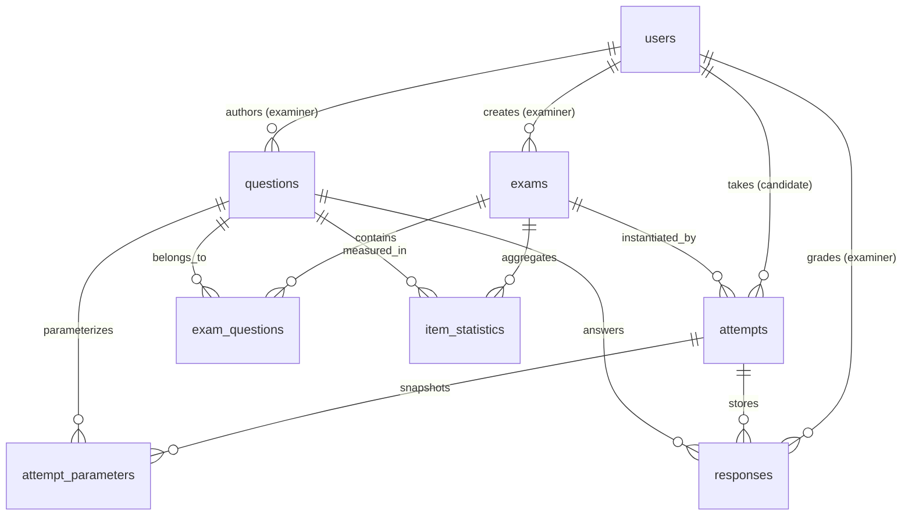

# Plan — Relational Database Schema & Domain Models

> **Superseded by P1 (schema v2), split into P1a–P1d** — see [application-roadmap.md](application-roadmap.md) and [p1a-accounts-competences-classes.md](p1a-accounts-competences-classes.md). Kept for history; do not build from it. It predates D-015, D-025–D-032 and D-039 and cites the superseded D-010.

## Size
**M** — Scaffolds local PostgreSQL 16 via Docker Compose (`docker compose up`), 8 Eloquent schema migrations with strict foreign key constraints, indexes, and JSONB fields, 8 Eloquent models with bi-directional relationships, and Pest schema verification tests.

## Approach
Implement the PostgreSQL 16 relational database schema in `backend/database/migrations/` adhering to [D-003](../agents/DECISIONS.md#D-003), [D-004](../agents/DECISIONS.md#D-004), [D-005](../agents/DECISIONS.md#D-005), [D-006](../agents/DECISIONS.md#D-006), [D-010](../agents/DECISIONS.md#D-010), [D-011](../agents/DECISIONS.md#D-011), and [D-012](../agents/DECISIONS.md#D-012). The design establishes 8 interconnected tables providing referential integrity, state machine tracking for attempts, concrete parameter snapshotting for parameterized audits, response autosave versioning, handwritten solution file links, and psychometric aggregation. Alternatives rejected: MongoDB / document-only storage (forbidden by catalog requirement for relational integrity) and unnormalized JSON-only attempt logs (fails audit and relational grading requirements).

## Schema Entity Relationship

## Detailed Table Specifications

### 1. `users`
**Purpose:** Platform actors (Candidates, Examiners, Administrators) with authentication credentials and approval states.
| Column | Type | Constraints / Defaults | Description |
|---|---|---|---|
| `id` | `BIGSERIAL` | `PRIMARY KEY` | Unique user identifier |
| `name` | `VARCHAR(255)` | `NOT NULL` | Full name of candidate, examiner, or admin |
| `email` | `VARCHAR(255)` | `NOT NULL, UNIQUE` | Login email address |
| `password` | `VARCHAR(255)` | `NOT NULL` | Bcrypt or Argon2id hashed password |
| `role` | `VARCHAR(32)` | `NOT NULL, DEFAULT 'candidate'` | Enum: `candidate`, `examiner`, `administrator` |
| `is_active` | `BOOLEAN` | `NOT NULL, DEFAULT true` | `true` for candidates/admins; `false` for unapproved examiners |
| `email_verified_at`| `TIMESTAMP` | `NULLABLE` | Optional verification timestamp |
| `remember_token` | `VARCHAR(100)` | `NULLABLE` | Session token |
| `created_at`, `updated_at` | `TIMESTAMP` | `NOT NULL` | Laravel audit timestamps |

---

### 2. `questions`
**Purpose:** Mathematics question bank master records supporting multiple grade levels (with 6th-grade math as initial 60-item reference pool).
| Column | Type | Constraints / Defaults | Description |
|---|---|---|---|
| `id` | `BIGSERIAL` | `PRIMARY KEY` | Unique question identifier |
| `examiner_id` | `BIGINT` | `NOT NULL, FK -> users(id)` | Author/creator of the question |
| `title` | `VARCHAR(255)` | `NOT NULL` | Short descriptive label (e.g., "Suma unghiurilor într-un triunghi") |
| `content` | `TEXT` | `NOT NULL` | Mathematical statement with placeholders (e.g., "Calculați $x$ dacă $a = {a}$...") |
| `grade_level` | `VARCHAR(32)` | `NOT NULL, DEFAULT 'grade_6'`| Target grade level (e.g. `grade_5`, `grade_6`, `grade_7`, `grade_8`) |
| `section` | `VARCHAR(32)` | `NOT NULL` | Enum: `subject_1` (auto-graded, binary) or `subject_2` (manual multi-step) |
| `type` | `VARCHAR(32)` | `NOT NULL` | `dual_choice`, `single_choice`, `multiple_choice`, `short_answer`, `parameterized_numeric`, `structured_problem` |
| `default_points` | `DECIMAL(5,2)`| `NOT NULL, DEFAULT 5.00` | Standard points (5.00 for Subject 1; 15.00-20.00 for Subject 2) |
| `difficulty` | `VARCHAR(16)` | `NOT NULL` | Enum: `easy`, `medium`, `hard` |
| `topic` | `VARCHAR(64)` | `NOT NULL` | Mathematics topic (e.g. `multimi_numere`, `rapoarte_proportii`, `triunghiuri`) |
| `solution_explanation` | `TEXT`| `NULLABLE` | Detailed pedagogical explanation shown post-grading |
| `metadata` | `JSONB` | `NOT NULL, DEFAULT '{}'` | Options, formula definitions, variable ranges (`{ "a": {"min": 2, "max": 10} }`), tolerance (= 0) |
| `created_at`, `updated_at` | `TIMESTAMP` | `NOT NULL` | Laravel audit timestamps |

---

### 3. `exams`
**Purpose:** Exam templates configured by examiners with timing, baseline points, grade targeting, and grading policies.
| Column | Type | Constraints / Defaults | Description |
|---|---|---|---|
| `id` | `BIGSERIAL` | `PRIMARY KEY` | Unique exam identifier |
| `examiner_id` | `BIGINT` | `NOT NULL, FK -> users(id)` | Examiner who owns the exam |
| `title` | `VARCHAR(255)` | `NOT NULL` | Title of the assessment |
| `description` | `TEXT` | `NULLABLE` | Exam instructions and candidate guidance |
| `grade_level` | `VARCHAR(32)` | `NULLABLE` | Target grade level (e.g., `'grade_6'`) |
| `duration_minutes` | `INTEGER` | `NOT NULL, DEFAULT 50` | Authoritative assessment duration in minutes |
| `baseline_points` | `DECIMAL(5,2)`| `NOT NULL, DEFAULT 10.00`| Baseline points (*din oficiu*) per D-005 |
| `max_attempts` | `INTEGER` | `NOT NULL, DEFAULT 1` | Allowed attempts per candidate (1 or multiple per D-012) |
| `score_aggregation`| `VARCHAR(16)` | `NOT NULL, DEFAULT 'highest'`| Score policy: `highest` or `latest` (D-012) |
| `start_time` | `TIMESTAMP` | `NULLABLE` | Availability window opening |
| `end_time` | `TIMESTAMP` | `NULLABLE` | Availability window closing |
| `is_published` | `BOOLEAN` | `NOT NULL, DEFAULT false`| Published to candidates |
| `feedback_published_at`| `TIMESTAMP` | `NULLABLE` | When examiner explicitly releases grades per D-010 |
| `cohort_feedback` | `TEXT` | `NULLABLE` | Single global cohort note published all at once per D-010 |
| `created_at`, `updated_at` | `TIMESTAMP` | `NOT NULL` | Laravel audit timestamps |

---

### 4. `exam_questions` (Pivot)
**Purpose:** Associates questions with an exam template, defining question order and point values.
| Column | Type | Constraints / Defaults | Description |
|---|---|---|---|
| `id` | `BIGSERIAL` | `PRIMARY KEY` | Unique pivot record identifier |
| `exam_id` | `BIGINT` | `NOT NULL, FK -> exams(id) ON DELETE CASCADE` | Associated exam |
| `question_id` | `BIGINT` | `NOT NULL, FK -> questions(id) ON DELETE CASCADE`| Associated question |
| `order_index` | `INTEGER` | `NOT NULL` | 1-based display sequence in exam |
| `assigned_points` | `DECIMAL(5,2)`| `NOT NULL` | Points allocated for this exam instance |
| **Indexes:** | `UNIQUE(exam_id, question_id)`, `UNIQUE(exam_id, order_index)` | Ensures uniqueness and ordering integrity |

---

### 5. `attempts`
**Purpose:** An instance of a candidate taking an exam. Governed by a server-side state machine.
| Column | Type | Constraints / Defaults | Description |
|---|---|---|---|
| `id` | `BIGSERIAL` | `PRIMARY KEY` | Unique attempt identifier |
| `exam_id` | `BIGINT` | `NOT NULL, FK -> exams(id) ON DELETE CASCADE` | Exam being attempted |
| `candidate_id` | `BIGINT` | `NOT NULL, FK -> users(id)` | Candidate taking the exam |
| `attempt_number` | `INTEGER` | `NOT NULL, DEFAULT 1` | Sequential attempt index for this candidate |
| `seed` | `BIGINT` | `NOT NULL` | PRNG seed ensuring reproducible parameter generation |
| `status` | `VARCHAR(32)` | `NOT NULL, DEFAULT 'started'` | Enum: `started`, `in_progress`, `submitted`, `graded` |
| `started_at` | `TIMESTAMP` | `NOT NULL` | Server clock start timestamp |
| `expires_at` | `TIMESTAMP` | `NOT NULL` | Server expiration timestamp (`started_at + duration`) |
| `grace_period_seconds`| `INTEGER` | `NOT NULL, DEFAULT 30` | 30-second network latency buffer per D-004 |
| `submitted_at` | `TIMESTAMP` | `NULLABLE` | Explicit submission or auto-sealing timestamp |
| `subject_1_score` | `DECIMAL(5,2)`| `NOT NULL, DEFAULT 0.00` | Auto-graded Subject 1 sum (max 30.00) |
| `subject_2_score` | `DECIMAL(5,2)`| `NOT NULL, DEFAULT 0.00` | Manual-graded Subject 2 sum (max 60.00) |
| `total_score` | `DECIMAL(5,2)`| `NOT NULL, DEFAULT 10.00`| Final grade: baseline (10.00) + S1 + S2 (max 100.00) |
| `created_at`, `updated_at` | `TIMESTAMP` | `NOT NULL` | Laravel audit timestamps |
| **Indexes:** | `UNIQUE(exam_id, candidate_id, attempt_number)` | Prevents duplicate attempt collisions |

---

### 6. `attempt_parameters`
**Purpose:** Auditability archive permanently snapshotting concrete evaluated values for parameterized questions per D-006.
| Column | Type | Constraints / Defaults | Description |
|---|---|---|---|
| `id` | `BIGSERIAL` | `PRIMARY KEY` | Unique parameter record identifier |
| `attempt_id` | `BIGINT` | `NOT NULL, FK -> attempts(id) ON DELETE CASCADE` | Associated attempt |
| `question_id` | `BIGINT` | `NOT NULL, FK -> questions(id) ON DELETE CASCADE` | Associated parameterized question |
| `parameters` | `JSONB` | `NOT NULL` | Concrete evaluated values (e.g. `{"a": 12, "b": 4, "x": 3}`) |
| `computed_correct_answer`| `TEXT` | `NOT NULL` | Exact formula result computed server-side for this attempt |
| `created_at`, `updated_at` | `TIMESTAMP` | `NOT NULL` | Snapshot creation timestamp |
| **Indexes:** | `UNIQUE(attempt_id, question_id)` | Single immutable parameter set per question attempt |

---

### 7. `responses`
**Purpose:** Candidate answers, autosave versioning, uploaded handwritten proofs, and examiner partial grading.
| Column | Type | Constraints / Defaults | Description |
|---|---|---|---|
| `id` | `BIGSERIAL` | `PRIMARY KEY` | Unique response identifier |
| `attempt_id` | `BIGINT` | `NOT NULL, FK -> attempts(id) ON DELETE CASCADE` | Associated attempt |
| `question_id` | `BIGINT` | `NOT NULL, FK -> questions(id) ON DELETE CASCADE` | Question being answered |
| `response_data` | `JSONB` | `NOT NULL, DEFAULT '{}'` | Candidate answer (selected option ID, numeric input, or reasoning text) |
| `uploaded_image_path` | `VARCHAR(512)`| `NULLABLE` | Local server path for handwritten proof photo per D-011 |
| `version` | `INTEGER` | `NOT NULL, DEFAULT 1` | Monotonic incrementing version counter for idempotent autosave |
| `is_auto_graded` | `BOOLEAN` | `NOT NULL, DEFAULT false`| `true` for auto-graded Subject 1; `false` for Subject 2 |
| `awarded_points` | `DECIMAL(5,2)`| `NULLABLE` | Graded points awarded (binary for S1; partial credit for S2) |
| `examiner_comment` | `TEXT` | `NULLABLE` | Private per-problem feedback note from examiner per D-010 |
| `graded_by` | `BIGINT` | `NULLABLE, FK -> users(id)` | Examiner who graded the response |
| `graded_at` | `TIMESTAMP` | `NULLABLE` | Timestamp when grading occurred |
| `created_at`, `updated_at` | `TIMESTAMP` | `NOT NULL` | Laravel audit timestamps |
| **Indexes:** | `UNIQUE(attempt_id, question_id)` | One response record per question in an attempt |

---

### 8. `item_statistics`
**Purpose:** Psychometric evaluation aggregating item difficulty, discrimination, and distractor usage per exam.
| Column | Type | Constraints / Defaults | Description |
|---|---|---|---|
| `id` | `BIGSERIAL` | `PRIMARY KEY` | Unique psychometrics record identifier |
| `exam_id` | `BIGINT` | `NOT NULL, FK -> exams(id) ON DELETE CASCADE` | Target exam |
| `question_id` | `BIGINT` | `NOT NULL, FK -> questions(id) ON DELETE CASCADE`| Target question |
| `attempts_count` | `INTEGER` | `NOT NULL, DEFAULT 0` | Total candidate responses evaluated |
| `correct_count` | `INTEGER` | `NOT NULL, DEFAULT 0` | Total full-credit responses |
| `difficulty_index`| `DECIMAL(5,4)`| `NOT NULL, DEFAULT 0.0000` | Facility index ($P = \text{correct} / \text{total}$), 0.0000 to 1.0000 |
| `discrimination_index`| `DECIMAL(5,4)`| `NOT NULL, DEFAULT 0.0000` | Point-biserial correlation ($r_{pb}$) between item and total test score |
| `distractor_frequencies`| `JSONB` | `NOT NULL, DEFAULT '{}'` | Distribution counts per choice option (e.g. `{"A": 14, "B": 2, "C": 1}`) |
| `last_calculated_at`| `TIMESTAMP` | `NOT NULL` | Calculation timestamp |
| `created_at`, `updated_at` | `TIMESTAMP` | `NOT NULL` | Record timestamps |
| **Indexes:** | `UNIQUE(exam_id, question_id)` | One statistical summary per question per exam |

## Files
| Action | Path | What |
|---|---|---|
| create | `docker-compose.yml` | PostgreSQL 16 service definition (`exam_platform_db`) with volume persistence |
| create | `backend/database/migrations/0001_01_01_000000_create_users_table.php` | Users schema: roles (`candidate`, `examiner`, `administrator`) and `is_active` |
| create | `backend/database/migrations/2026_11_18_000001_create_questions_table.php` | Questions schema: section (`subject_1`, `subject_2`), type, difficulty, metadata |
| create | `backend/database/migrations/2026_11_18_000002_create_exams_table.php` | Exams schema: baseline points (10), duration, attempts policy, cohort feedback |
| create | `backend/database/migrations/2026_11_18_000003_create_exam_questions_table.php` | Pivot schema: ordering and point allocation within exam |
| create | `backend/database/migrations/2026_11_18_000004_create_attempts_table.php` | Attempts state machine schema: `started`, `in_progress`, `submitted`, `graded`, timer timestamps, grace period |
| create | `backend/database/migrations/2026_11_18_000005_create_attempt_parameters_table.php` | Parameter audit snapshot schema: concrete evaluated values & computed answer |
| create | `backend/database/migrations/2026_11_18_000006_create_responses_table.php` | Responses schema: candidate answers, autosave versioning, handwritten photo path, partial points, individual comments |
| create | `backend/database/migrations/2026_11_18_000007_create_item_statistics_table.php` | Psychometrics schema: difficulty index ($P$), discrimination ($r_{pb}$), distractors |
| create | `backend/app/Models/User.php` | Eloquent User model with relations to exams, questions, attempts |
| create | `backend/app/Models/Question.php` | Eloquent Question model with casts (`metadata` => `array`) and relations |
| create | `backend/app/Models/Exam.php` | Eloquent Exam model with duration, feedback timestamps, relations |
| create | `backend/app/Models/ExamQuestion.php` | Pivot model linking Exam and Question with points and order |
| create | `backend/app/Models/Attempt.php` | Eloquent Attempt model with state machine helper transitions |
| create | `backend/app/Models/AttemptParameter.php` | Eloquent model for persistent attempt parameter snapshots |
| create | `backend/app/Models/Response.php` | Eloquent Response model with versioning and grading attributes |
| create | `backend/app/Models/ItemStatistic.php` | Eloquent model for psychometric metrics storage |
| create | `backend/database/seeders/DatabaseSeeder.php` | Database seeder orchestrating initial users and sample questions |
| create | `backend/tests/Feature/SchemaAndRelationsTest.php` | Pest tests asserting foreign key constraints, cascading deletes, and model relations |

## Tests
| # | Behaviour | Test (file · kind) | Not automated? why |
|---|---|---|---|
| 1 | Migrations run up and down cleanly without SQL syntax or type errors | `backend/tests/Feature/SchemaAndRelationsTest.php` · Pest integration | Automated |
| 2 | Foreign keys enforce integrity (deleting an exam cascades to `exam_questions` and `attempts`) | `backend/tests/Feature/SchemaAndRelationsTest.php` · Pest integration | Automated |
| 3 | Attempt status enforces valid state values (`started`, `in_progress`, `submitted`, `graded`) | `backend/tests/Feature/SchemaAndRelationsTest.php` · Pest integration | Automated |
| 4 | Attempt parameter persistence guarantees unique snapshot per (`attempt_id`, `question_id`) | `backend/tests/Feature/SchemaAndRelationsTest.php` · Pest integration | Automated |
| 5 | Response record stores JSON candidate answers and handwritten photo path | `backend/tests/Feature/SchemaAndRelationsTest.php` · Pest integration | Automated |
| 6 | Eloquent model relationships correctly navigate bi-directional associations | `backend/tests/Feature/SchemaAndRelationsTest.php` · Pest integration | Automated |

## Design (UI only)
*None* — Database schema and persistence layer only.

## Sequencing
one builder (sequential: `docker-compose.yml` → Migrations 1 through 7 → Eloquent Models & casts → Pest Schema & Relation Tests).

## Risks
- PostgreSQL JSONB compatibility during testing: Tests must run against PostgreSQL (via Docker or test container) rather than SQLite to ensure JSONB operators and constraint semantics behave identically to production.
  *Fallback:* Pest configured to connect to PostgreSQL test database defined in `docker-compose.yml`.

## Out of scope
- API controllers and HTTP request routes (planned in dedicated feature plans).
- Sandboxed mathematical parser logic (handled in parameterized math engine plan).
- Frontend UI components and screens.

## Knowledge used
| Entry | What it says | Why it applies | Call |
|---|---|---|---|
| D-001 | Plan-then-build workflow | Mandates planning before editing | confirm |
| D-002 | Laravel 11 REST API backend with React + Vite SPA | Governs Eloquent ORM & migrations layer | confirm |
| D-003 | PostgreSQL 16 with local Docker Compose orchestration | Specifies database engine and local containerization | confirm |
| D-004 | Authoritative server timer with 30-second expiration grace period | Informs `started_at`, `expires_at`, `grace_period_seconds` on `attempts` | confirm |
| D-005 | Two-part assessment scoring architecture with zero negative marking | Informs `section` on `questions` and baseline/score fields on `attempts` | confirm |
| D-006 | Exact-match numeric tolerance with concrete parameter persistence | Dictates `attempt_parameters` table structure | confirm |
| D-008 | Pest PHP, Vitest, and Playwright as automated testing stack | Establishes Pest PHP as test runner | confirm |
| D-009 | Two-folder monorepo layout (backend/ and frontend/) | Places database files in `backend/database/` | confirm |
| D-010 | Two-step examiner feedback publication after full grading | Dictates `cohort_feedback` on `exams` and `examiner_comment` on `responses` | confirm |
| D-011 | Subject 2 handwritten solution photo upload alongside text | Dictates `uploaded_image_path` on `responses` | confirm |
| D-012 | Configurable attempt limits and score aggregation policy | Dictates `max_attempts` and `score_aggregation` on `exams` | confirm |

### Considered, not applied
- D-007 (Visual design tokens) — No UI involved in database schema.
- D-013 (Sandboxed PHP math expression library) — Evaluator logic is out of scope for schema definitions.

### Assumptions (no entry behind them)
- JSONB columns are used for question options, concrete parameter mappings, and distractor frequency distributions for native query efficiency.
